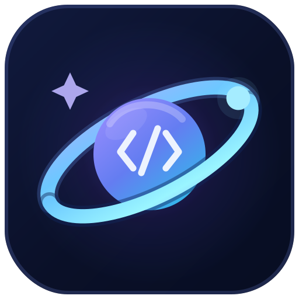

<p align="center">
  
</p>

# RepoAstral

**Your coding universe.**

<p>
  <a href="https://github.com/sponsors/hoangduy0610" title="Sponsor hoangduy0610">
    
  </a>
</p>

RepoAstral turns a public GitHub profile into an interactive 3D solar system. The developer is the central star, repositories become planets, stars influence their size, and programming languages seed their visual identity.

No sign-in or database is required. Enter a GitHub username and explore the generated universe
directly in the browser.

## Features

- Interactive Three.js universe with orbit, pan, and zoom controls
- Procedural gas, rocky, ice, and volcanic planet surfaces
- Deterministic layouts generated from repository data
- Repository labels with names, languages, and star counts
- Profile statistics and repository detail panels
- Pause, reset, and camera controls
- Shareable profile URLs
- 4K PNG export with an automatically arranged repository index
- Responsive landing page and explorer interface

## How the visualization works

| GitHub data            | Visualization                               |
| ---------------------- | ------------------------------------------- |
| User profile           | Central star                                |
| Public repository      | Planet                                      |
| Star count             | Planet size and visual prominence           |
| Primary language       | Surface color palette                       |
| Planet size            | Orbit distance                              |
| Repository ID and name | Stable position and procedural surface seed |

RepoAstral fetches up to 300 owner repositories, removes forks, sorts the result by stars and
recent activity, and visualizes up to 40 repositories. Smaller planets occupy inner orbits while
larger planets move outward to preserve spacing.

## Tech stack

- [Next.js 14](https://nextjs.org/) with the App Router
- [React 18](https://react.dev/)
- [TypeScript](https://www.typescriptlang.org/)
- [Three.js](https://threejs.org/) for the 3D scene
- [Tailwind CSS](https://tailwindcss.com/)
- [Lucide](https://lucide.dev/) icons
- GitHub REST API
- Prettier with Tailwind class sorting

## Getting started

### Requirements

- Node.js 20 or newer
- npm

### Installation

```bash
git clone <your-repository-url>
cd repo-astral
npm install
```

Create an optional `.env.local` file with a GitHub personal access token:

```bash
GITHUB_TOKEN=your_token_here
NEXT_PUBLIC_SITE_URL=https://your-domain.example
```

The app works without a token, but authenticated GitHub API requests have a higher rate limit.
Only public profile and repository data is requested. `NEXT_PUBLIC_SITE_URL` ensures social preview
images resolve against the correct domain when deploying outside Vercel.

Start the development server:

```bash
npm run dev
```

Open [http://localhost:3000](http://localhost:3000).

## Available scripts

| Command                | Description                                         |
| ---------------------- | --------------------------------------------------- |
| `npm run dev`          | Start the Next.js development server                |
| `npm run build`        | Create a production build                           |
| `npm run start`        | Start the production server                         |
| `npm run lint`         | Run the Next.js linter                              |
| `npm run format`       | Format the repository with Prettier                 |
| `npm run format:check` | Verify that files follow the Prettier configuration |

## Project structure

```text
app/
  api/github/[username]/  GitHub data endpoint
  u/[username]/           Generated universe page
  layout.tsx              Root layout and fonts
  page.tsx                Landing page
components/
  explorer.tsx            Universe UI, panels, and controls
  landing.tsx             Landing page and SVG hero system
  universe-canvas.tsx     Three.js scene, labels, and PNG export
lib/
  github.ts               GitHub REST API client
  types.ts                Shared application types
  universe.ts             Planet sizing and orbit layout
```

## Controls

- **Drag:** orbit the camera
- **Scroll or pinch:** zoom
- **Right-drag:** pan
- **Click a planet:** open repository details
- **Pause:** stop orbital motion
- **Reset:** restore the default camera
- **Export:** download the current universe as a 4K PNG

## Data and privacy

RepoAstral does not require GitHub OAuth and does not access private repositories. The current
MVP does not use a database or persist visitor data. GitHub responses are cached through Next.js
for 15 minutes to reduce API usage.

## Product specification

See [REQUIREMENTS.md](./REQUIREMENTS.md) for the original product requirements and acceptance
criteria.
